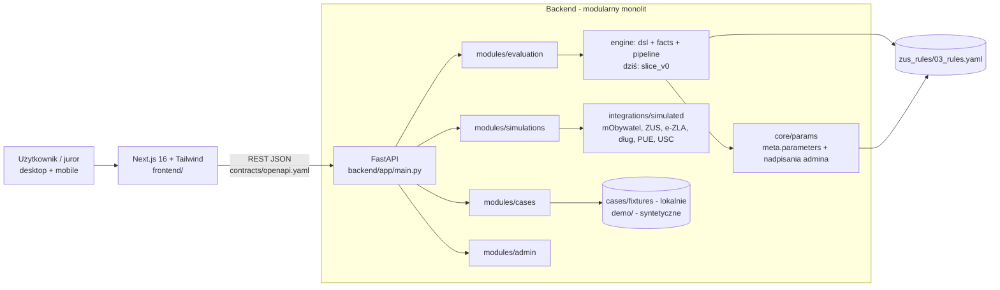

# ARCHITECTURE

## Diagram

## Komponenty
| Komponent | Ścieżka | Odpowiedzialność | Stan |
|---|---|---|---|
| Kontrakt API | `contracts/openapi.yaml` | Jedno źródło kontraktu BE/FE (właściciel: Integrator) | **v1**: 14 operacji - `implemented`: `/api/health`, `/api/evaluate`; `planned`: sprawy, admin, symulacje (`x-task` wskazuje zadanie). Modele = `zus_rules/04`/`05` (`In*`/`Out*`) |
| Specyfikacja prawa | `zus_rules/` | Reguły YAML, schematy wejścia/wyjścia, obliczenia, testy, luki | gotowa (audyt 0 błędów) |
| Silnik | `backend/app/engine/` | Deterministyczna ewaluacja reguł (logika Kleene) | **slice_v0** (podzbiór, tymczasowy) |
| Parametry | `backend/app/core/params.py` | Wartości liczbowe wyłącznie z `meta.parameters` | odczyt; admin - BE2-05 |
| Moduły API | `backend/app/modules/` | Routery FastAPI per domena | `evaluation` |
| Adaptery symulacji | `backend/app/integrations/simulated/` | Mocki systemów trzecich: serwis per system, scenariusze z wejścia (opis niżej: „Symulowane systemy trzecie”) | INT-03 |
| Frontend | `frontend/src/` | `app/` (strony), `features/` (domeny UI), `components/`, `lib/` (klient API, formatowanie) | kalkulator slice |
| Dane demo | `demo/` | Scenariusze **syntetyczne** do testów i demo | 1 scenariusz |

## Symulowane systemy trzecie (mocki, INT-03)
Wszystkie integracje z systemami zewnętrznymi są **wyłącznie symulowane** (D8) - to czyste klasy Pythona, bez WireMocka i json-servera. Kod: `backend/app/integrations/simulated/`, po jednym serwisie na system; HTTP: `backend/app/modules/simulations/router.py` (`/api/sim/*`, kontrakt w `contracts/openapi.yaml`, każda odpowiedź ma `simulated: true`).

| System udawany | Serwis (plik) | Endpoint `/api/sim/*` |
|---|---|---|
| mObywatel (logowanie) | `MObywatelService` - `mobywatel.py` | `POST /mobywatel/login` |
| Konto ZUS/PUE (ubezpieczenie, płatnik, podstawa) | `ZusAccountService` - `zus_account.py` | `GET /zus-profile` |
| e-ZLA | `EzlaService` - `ezla.py` | `GET /ezla` |
| Zadłużenie składkowe | `DebtService` - `debt.py` | `GET /debt-certificate` |
| PUE/eZUS (pytanie) | `PueService` - `pue.py` | `POST /pue-question` |
| Wnioski (ZAM, urlopowe) | `ApplicationService` - `applications.py` | `POST /applications` |
| USC (odpis aktu urodzenia) | `CivilRegistryService` - `civil_registry.py` | `POST /birth-certificate` |

- Fasada `SimulatedSystems` (`systems.py`) składa wszystkie serwisy; `common.py` - wspólne pomocniki; `profiles.py` - 7 profili syntetycznych (`employee_mother`, `self_employed_debt`, `father_takeover`, `voluntary_short_waiting`, `gap_in_insurance`, `twins_employee`, `adoptive_father`).
- **Scenariusze zależą od wejścia:** metody przyjmują profil i nadpisania (np. `payer_insured_count`, `event_date`, `amount_override`, `submitted_on`, filtry e-ZLA), więc jedną implementacją odtwarza się różne przypadki (mały płatnik → ZUS, dług na dzień X, wniosek po terminie).
- Progi i terminy tylko z `param()`; identyfikatory deterministyczne (`*-SIM-XXXXXXXX`); zegar wstrzykiwany (`SimulatedSystems(today=...)`).
- Testy: `backend/tests/test_sim_services.py`. To nie jest integracja - nie przedstawiamy mocków jako działających połączeń; na slajdzie „ścieżka wdrożenia” wskazujemy docelowe systemy.

## Krytyczne przepływy
1. **Ewaluacja:** FE → `POST /api/evaluate` (podzbiór `04`) → silnik → odpowiedź (podzbiór `05`) → karty wyników. Kwoty jako string dziesiętny, bez przeliczania w FE.
2. **Sprawa ZUS:** wybór/upload → mapowanie do `04` → ewaluacja → porównanie z `expected` (zadanie BE2-06).
3. **Parametry:** admin zmienia parametr (wersja, `valid_from`) → kolejne ewaluacje używają nowej wartości bez redeployu.

## Przejście slice → pełny silnik
`app/engine/slice_v0.py` liczy tylko urlop macierzyński matki i jawnie zwraca `not_evaluated_rules`. Docelowo `app/engine/pipeline.evaluate(payload)` (BE1-02) wykonuje `03_rules.yaml`; router przełącza się zmienną `ENGINE=rules|slice` do czasu przejścia wszystkich testów `08`.

## Uruchomienie
- Windows: `scripts\dev.ps1` (backend :8000, frontend :3000), weryfikacja `scripts\verify.ps1 [-Smoke]`.
- Docker: `docker compose up --build`, smoke `python scripts/smoke.py --wait 90`.
- Deploy publiczny (wymagany przez zadanie): zadanie INT-02 - wyłącznie po decyzji lidera (konta, koszty).

## Pojedyncze punkty awarii
Hosting demo w czasie oceny (cold start) · brak spraw ZUS (M01) · zaokrąglenia kwot (M04) · plik `03_rules.yaml` edytowany przez wiele osób (właściciel: BA + BE-1).
