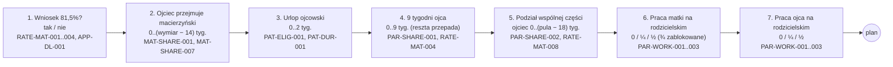

# PLANNER — graf opcji i optymalizator wyborów urlopowych (BE2-07)

Funkcja „podpowiedz najlepszy następny wybór”: dla rodziny (podstawy obojga rodziców, liczba dzieci, „Za życiem”) buduje graf wszystkich dozwolonych wyborów z `zus_rules/03_rules.yaml`, liczy najlepszy możliwy plan i ocenia każdą opcję bieżącego kroku. Umie też **cofnąć się o N kroków** i wskazać, że wcześniejszy wybór był gorszy (np. „cofnij się o 2 kroki: ojciec powinien przejąć wspólną część rodzicielskiego — +16 919,51 zł”).

Kod: `backend/app/engine/planner/` (`model.py` — kroki i ograniczenia, `optimizer.py` — DP, sugestia, cofanie, graf), API: `backend/app/modules/planner/`, kontrakt: `contracts/openapi.yaml` (`/api/planner/suggest`, `/api/planner/graph`), testy: `backend/tests/test_planner.py`.

## Graf decyzji

Kroki są w stałej kolejności. Opcje zablokowane regułą są w grafie (`feasible: false`, `blocked_by_rule`), żeby UI mógł pokazać, *dlaczego* czegoś nie wolno.

| Krok | Opcje | Ograniczenia (reguła) | Stawka (reguła) |
|---|---|---|---|
| `COMBINED_815` | tak / nie | — | 81,5% za macierzyński i rodzicielski matki (RATE-MAT-003) albo 100% / 70% (RATE-MAT-001/002) |
| `MATERNITY_TRANSFER` | 0..wymiar tyg. | matka ≥ 14 tyg. (MAT-SHARE-001), łączny wymiar (MAT-SHARE-007), ojciec ubezpieczony | ojciec 100% (RATE-MAT-001) |
| `PATERNITY` | 0..2 tyg. | ojciec ubezpieczony (PAT-ELIG-001), wymiar (PAT-DUR-001) | 100% (RATE-MAT-001) |
| `FATHER_RESERVED_9W` | 0..9 tyg. | nieprzenoszalne (PAR-SHARE-001), ojciec ubezpieczony (PAR-ELIG-001) | 70% (RATE-MAT-002/004) |
| `SHARED_PARENTAL_SPLIT` | ojciec 0..pula−18 tyg. | pula 41/43/65/67 (PAR-DUR-001/002), suma ≤ pula (PAR-SHARE-002) | matka 81,5%/70%; ojciec 70%, przy 81,5% matki — **do weryfikacji** (RATE-MAT-008) |
| `WORK_MOTHER`, `WORK_FATHER` | 0, ¼, ½, (¾) | ≤ ½ etatu (PAR-WORK-001), limit wydłużenia 82/86/130/134 tyg. (PAR-WORK-002) | zasiłek × (1 − wymiar) (PAR-WORK-003) + wydłużenie + wynagrodzenie |

Wszystkie liczby (tygodnie, stawki, progi) pochodzą z `meta.parameters` przez `param()`. Pula, wymiar macierzyńskiego i limit wydłużenia zależą od liczby dzieci i „Za życiem”.

## Jak liczy

- **Węzeł** = (krok, stan). Stan zawiera tylko to, od czego zależą dalsze kroki: wniosek 81,5%, tygodnie rodzicielskiego matki i ojca, wykorzystane wydłużenie. Dzięki temu 90 tys. pełnych ścieżek (1 dziecko) mieści się w ok. 6 tys. węzłów.
- **Zysk krawędzi** jest addytywny: kwota zasiłku = podstawa × stawka / 30 × dni (07 §8), tydzień = 7 dni. Najlepszy plan = najdłuższa ścieżka w DAG (programowanie dynamiczne z memoizacją, odpowiedź w ułamku sekundy). Test `test_dp_equals_brute_force` porównuje wynik z pełnym przeszukaniem wszystkich ścieżek.
- **Cel** (`objective`): `MAX_MONEY` (kwota, potem dni opieki) albo `MAX_TIME` (dni opieki, potem kwota). Przy remisie wygrywa plan bez reguł „do weryfikacji”.
- **Sugestia** (`POST /api/planner/suggest`, `choices` = dotychczasowe wybory): każda opcja bieżącego kroku z najlepszym osiągalnym wynikiem (`best_total_exact`) i stratą do najlepszej (`loss_vs_best_exact`), `recommended`, `explanation`, podpowiedź kroku (`step.hint`, np. ile wart jest tydzień u matki i u ojca), `current_best_plan` (najlepsze dokończenie bieżącej ścieżki) i `global_best_plan`.
- **Cofanie** (`lookback`, domyślnie 2): dla kroków 1..N wstecz sprawdza, czy *zmiana tego kroku* (z optymalną resztą) daje więcej niż jego zachowanie i optymalne dokończenie. Raportowane są tylko takie kroki — zysk z poprawy samych późniejszych kroków przypisany jest do nich, nie do wcześniejszego.
- **Błędny wybór** (np. ojciec przejmuje 10 tyg. przy 1 dziecku) → `status: INVALID_CHOICE` z regułą (`MAT-SHARE-001`) i sugestią od ostatniego poprawnego kroku.
- **Graf** (`POST /api/planner/graph`, `depth` 1–7, domyślnie 5): węzły, krawędzie z zyskiem, katalog opcji kroku, liczba wszystkich planów, najlepszy plan. Pełny graf (`depth: 7`) to ok. 2 MB JSON.

## Przykład (dane syntetyczne: matka 6000 zł, ojciec 9000 zł, 1 dziecko, cel MAX_MONEY)

Najlepszy plan: bez 81,5%, ojciec przejmuje 6 tyg. macierzyńskiego, 2 tyg. ojcowskiego, 9 tyg. ojca i całą wspólną część (23 tyg.), oboje pracują na ½ etatu — 138 429,43 zł (z wynagrodzeniem za pracę) i 81 tyg. opieki. Po wyborach `[tak, 0, 2, 9, 0]` cofanie o 1 krok podpowiada: podział wspólnej części „matka 0, ojciec 23” — plan lepszy o 16 919,51 zł.

## Założenia i ograniczenia (zwracane w `assumptions`)

- Macierzyński przejęty przez ojca: 100% podstawy ojca (RATE-MAT-001; RATE-MAT-003 dotyczy urlopu wnioskodawczyni).
- Stawka ojca na wspólnej części przy wniosku 81,5% matki nie wynika jednoznacznie z przepisów (RATE-MAT-008) — liczona 70%, plan ma `needs_review: true`.
- Macierzyński od dnia porodu (bez części przedporodowej, MAT-DUR-002); rodzicielski zaraz po nim, więc RATE-MAT-005/006 nie zachodzą.
- Podwyższenie do świadczenia rodzicielskiego (RATE-MAT-007) pominięte — brak kwoty w materiałach (`PARENTAL_BENEFIT_FLOOR_MONTHLY: MISSING`).
- Praca na rodzicielskim: do kwoty planu doliczane jest wynagrodzenie brutto; bez podanego — szacunek podstawa / (1 − 13,71%). Łączna kwota zasiłku się nie zmienia (zmniejszenie = wydłużenie, KP 182(1f)).
- Dni opieki liczone przy kolejnym korzystaniu przez rodziców; ojcowski równolegle z matką (`together_days`).
- Kwoty bez zaokrągleń (GAP-001). Matka nieubezpieczona → `OUT_OF_SCOPE` (PAR-SHARE-003 jeszcze nie w planerze).

## Frontend — krok „Optymalizacja” w kreatorze
`frontend/src/features/main-flow/wizard/Optimizer.tsx`, krok `optimize` w `steps.tsx` (po „Wynagrodzenie”; widoczny dla mamy/taty przed porodem, gdy mama jest ubezpieczona). Pyta o wynagrodzenie drugiego rodzica i cel, potem prowadzi przez 7 decyzji: każda opcja z kwotą i stratą, „Polecane”, opcje zablokowane z przepisem, baner „Możecie zyskać X zł — wróć o N kroków” z przyciskiem, lista wyborów z „Zmień”. Wybory są w `Answers.plannerChoices` (przetrwają nawigację po kreatorze). „Użyj tego planu w kreatorze” przenosi plan do pól kroku „Plany” (tygodnie taty, przejęcie macierzyńskiego, praca mamy) i wariant 81,5% / 100-70 do wyniku. Klient: `plannerSuggest()` w `lib/api.ts` (w trybie mock niedostępny, z komunikatem).
Uwaga: podgląd wyniku w FE (`preview/engine.ts`, mock) liczy macierzyński przejęty przez tatę stawką wariantu (81,5%), planer — 100% (RATE-MAT-001); do ujednolicenia przy BE2-02.
