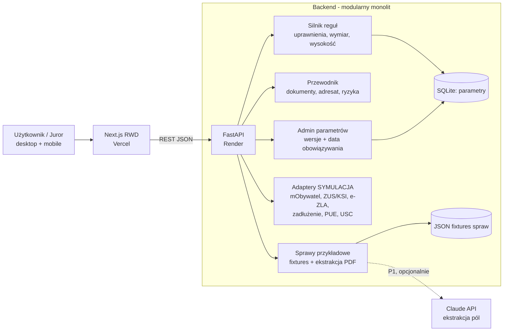
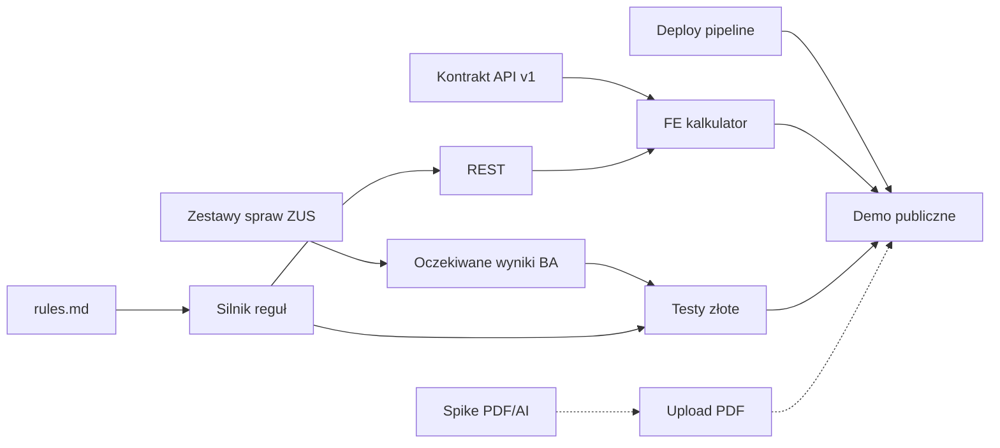

# HackNation 2026 - ZUS „Zasiłkowy Przewodnik Przyszłego Rodzica” - Battle Plan

**Start:** sobota 11:45 · **Deadline Hacktribe:** niedziela 11:00 · **Czas kalendarzowy:** 23 h 15 min (w briefie: „20 h” - przyjmuję ~20 h efektywnej pracy + rotacyjny sen, patrz §4).

Oznaczenia: **[OFICJALNE]** = cytat/wymóg z treści zadania lub regulaminu · **[REKOMENDACJA]** = nasza decyzja · **[NIEWIADOMA]** = do potwierdzenia u mentora / w spike'u.

> ⚠️ **Krytyczne ustalenie z materiałów:** w pobranym folderze **nie ma „przykładowych spraw”** (zestawów z ZAM/Z-3/poświadczeniem i wynikiem). Są tylko: wyciągi z ustawy zasiłkowej i KP, 2 rozporządzenia, Poradnik ZUS 2026 i Załącznik (tabele wymiarów/stawek). Jury **będzie testować na tych sprawach i sprawdzać poprawność wyliczeń** [OFICJALNE §6]. Zdobycie zestawów to zadanie nr 1 analityka w minucie 0.

---

## 1. EXECUTIVE SUMMARY

**CO BUDUJEMY**
Responsywną aplikację webową „Przewodnik Rodzica” z jednym **zintegrowanym kalkulatorem** (silnik reguł, nie AI), który dla konkretnej osoby - z symulowanych danych ZUS (mObywatel → „pobierz dane”), z ręcznie wpisanych danych albo **z wybranej/wgranej przykładowej sprawy ZUS** - ustala: czy przysługuje świadczenie (ciąża / macierzyński / rodzicielski / ojcowski / uzupełniający / przysposobienie / rodzina zastępcza), **na jak długo i w jakiej kwocie**, dla **obojga rodziców na osi czasu**, z wariantem łączenia pracy z rodzicielskim. Do wyniku dołączamy: listę dokumentów, **gdzie złożyć (płatnik vs ZUS)**, terminy, ryzyka utraty/obniżenia świadczeń, wsparcie organizacji charytatywnych. Parametry prawne (stawki %, wymiary tygodni, limity) są edytowalne w **panelu admina**.
**DLACZEGO TO WYSTARCZY**
Pokrywa punkty a–j „Oczekiwanego rezultatu” i wszystkie wymagane symulacje (mObywatel, dane ZUS, zadłużenie, e-ZLA, PUE/eZUS, wnioski, akt stanu cywilnego, linki), spełnia wymogi formalne (demo www z wyborem przykładów, RWD, repo, wideo ≤3 min, ≤10 slajdów, opis AI). Najmocniejsza karta to **mierzalna poprawność**: ekran „Weryfikacja na sprawach ZUS” pokazuje, że nasz silnik daje ten sam wynik co decyzja ZUS w X/N sprawach - trafia w *Związek z wyzwaniem* (25%) i *Kompletność/UX* (25%) oraz *Potencjał wdrożeniowy* (15%).

**CO MUSI DZIAŁAĆ (P0)**
1. Silnik reguł: prawo do świadczenia + wymiar + wysokość (z podstawy wymiaru).
2. Zintegrowany kalkulator (scenariusze: poród, wieloraczki, „Za życiem”, wcześniak/hospitalizacja, martwe urodzenie/zgon, adopcja, rodzina zastępcza niezawodowa, podział między rodziców, praca + rodzicielski, 81,5% vs 100/70).
3. Wybór/upload przykładowej sprawy → odczyt danych → wynik + porównanie z decyzją ZUS.
4. Ścieżka „ciąża”: zasiłek chorobowy / po ustaniu ubezpieczenia / w wysokości macierzyńskiego / świadczenie rehabilitacyjne + brak uprawnień.
5. Przewodnik: dokumenty, gdzie i kiedy złożyć, ryzyka, organizacje wsparcia, linki.
6. Symulacje (oznaczone „SYMULACJA”): mObywatel, dane z ZUS, zaświadczenie o niezaleganiu/zadłużeniu, e-ZLA, PUE/eZUS, wypełnienie wniosku, wniosek o odpis aktu urodzenia.
7. Panel admina parametrów (wersjonowany, przeliczenie po zmianie).
8. Deployment publiczny + RWD.

**CZEGO NIE BUDUJEMY**
Prawdziwych integracji (mObywatel, PUE, CEIDG, e-ZLA, USC), czatu AI jako źródła decyzji, kont użytkowników z hasłami, mikroserwisów, aplikacji mobilnej natywnej, pełnego workflow wysyłki wniosków, wielojęzyczności.

**NAJWIĘKSZE RYZYKO**
Błędne wyliczenia na sprawach ZUS (niezrozumiana podstawa wymiaru z Z-3 / zaokrąglenia / brak dostępu do zestawów spraw) → jury wprost to sprawdza.

**PIERWSZY KROK**
11:45 - BA idzie do stoiska ZUS po zestawy spraw + zadaje pytania Q1–Q3 (§15); równolegle 2 BE czytają ustawę/Załącznik i spisują reguły do `rules.md`; FE stawia szkielet Next.js; Dev5 robi spike deploymentu i spike ekstrakcji PDF.

---

## 2. ANALIZA WYZWANIA, KRYTERIÓW I MVP

### 2.1 Zrozumienie wyzwania

| Pytanie | Odpowiedź |
|---|---|
| Problem biznesowy | Rodzice nie wiedzą, co im przysługuje, ile, gdzie i kiedy złożyć; są zaskakiwani odmową (pozorna umowa, podwyższona podstawa w ciąży, brak ubezpieczenia na dzień porodu). Skutek dla ZUS: korespondencja o brakujące/błędne dokumenty, spory, sprawy sądowe, koszty, wizerunek. ZUS dowiaduje się o dziecku dopiero po porodzie. |
| Użytkownik | Osoby planujące rodzicielstwo, kobiety w ciąży, rodzice (oboje), rodzice adopcyjni, rodziny zastępcze niezawodowe. Różne tytuły ubezpieczenia: pracownik, zleceniobiorca, JDG. |
| Największy beneficjent | ZUS (mniej spraw wadliwych i sporów) + ubezpieczeni w sytuacjach złożonych (JDG z zadłużeniem, wcześniak, martwe urodzenie). |
| Obecny proces | Informacja rozproszona (poradnik PDF, zus.pl, gov.pl, PIP), wnioski ZAM/Z-3/Z-3a/ZAS-53, płatnik >20 ubezpieczonych wypłaca sam, inaczej ZUS. |
| Co ma się poprawić | Spersonalizowane ustalenie uprawnień + kwot **przed** zdarzeniem, świadome planowanie podziału urlopów, kierowanie do właściwego adresata wniosku, ostrzeganie o ryzykach. |
| Co jury chce zobaczyć | Działające demo www, na którym wybiorą przykładową sprawę i sprawdzą poprawność wyliczeń [OFICJALNE §6]; zintegrowany kalkulator [OFICJALNE - rekomendacja ZUS]; przegląd struktury kodu; potencjał produkcyjny. |

**Obowiązkowe vs interpretacja**
- Obowiązkowe [OFICJALNE §4]: opis+tytuł, prezentacja ≤10 slajdów, wideo ≤3 min w otwartym repozytorium (link). „Dodatkowo powinien zawierać”: repo, screenshoty, link do demo www z możliwością przetestowania wybranych przykładów (formularze PDF) i kalkulatora, pełna RWD, materiały graficzne, wskazanie funkcji z AI.
- Funkcje a–j i lista „Narzędzie powinno zapewnić możliwość” - sformułowane jako „powinno”: traktujemy jako **wymagane**, bo wprost pokrywają się z kryterium „Związek z wyzwaniem” i „Kompletność”.
- Panel admina parametrów - „powinno być tak zaprojektowane” → P0 w wersji minimalnej.
- Technologia: **dowolna**; preferowane FE React/Next.js, BE JS/Python/C#, REST [OFICJALNE §5].
- Interpretacja: punkty **e)** i **j)** to ten sam kalkulator (j bez słowa „niezawodowej”) → jedna funkcja; pytanie do mentora Q6.

**Konkurencyjne interpretacje**
1. *Portal informacyjny + kalkulator* (treści + formularz) - łatwe, mało oryginalne.
2. *Silnik decyzyjny na danych sprawy* (dokumenty → uprawnienia + kwota + weryfikacja z decyzją ZUS) - trudniejsze, ale dokładnie to jury testuje.
3. *Asystent AI/chatbot* - efektowne, ale ryzykowne merytorycznie (halucynacje w kwotach) i trudne do obrony.

**[REKOMENDACJA] 2 jako rdzeń + elementy 1 jako warstwa przewodnika; AI wyłącznie pomocniczo** (ekstrakcja danych z PDF, objaśnienia prostym językiem) z deterministycznym silnikiem jako jedynym źródłem kwot.

**Product Vision:** Osobisty przewodnik, który na podstawie danych z ZUS lub wpisanych przez rodzica pokazuje, co mu przysługuje w ciąży i po narodzinach dziecka, ile dostanie, jak podzielić urlopy z partnerem i co, gdzie i kiedy złożyć. Dla ZUS - mniej wadliwych wniosków i sporów dzięki informacji udzielonej, zanim urodzi się dziecko.

**Core Value Proposition:** „Wiesz, ile i na jak długo dostaniesz - zanim złożysz wniosek - wyliczone tak samo, jak policzy ZUS.”

**Main User Journey**
1. Wejście → „Zaloguj przez mObywatel (symulacja)” lub „Wybierz przykładową sprawę ZUS” / „Wgraj PDF”.
2. Pobranie danych (symulacja): tytuł ubezpieczenia, okresy, podstawa wymiaru, e-ZLA, zadłużenie składkowe.
3. Uzupełnienie sytuacji: termin porodu / data przyjęcia dziecka, liczba dzieci, „Za życiem”, wcześniak, drugi rodzic.
4. Wynik: karty świadczeń (przysługuje / nie przysługuje / brak danych + uzasadnienie z artykułem).
5. Planer osi czasu obojga rodziców (macierzyński → rodzicielski, 9 tyg. nieprzenoszalne, ojcowski, praca na ½ etatu) z kwotą miesięcznie i łącznie; porównanie 100/70 vs 81,5%.
6. „Co teraz zrobić”: lista dokumentów, adresat (pracodawca vs ZUS), terminy (np. 21 dni na wniosek 81,5%), ryzyka.
7. Wypełnij wniosek (symulacja) / pobierz podsumowanie PDF.

**Demo Success Moment**
Juror wybiera sprawę ZUS (np. przedsiębiorczyni z dobrowolnym chorobowym), aplikacja czyta dokumenty, pokazuje „ubezpieczona od…, 90 dni spełnione, zadłużenie 0 zł”, wylicza zasiłek **co do grosza** i wyświetla zielony znacznik **„Zgodne z decyzją ZUS ✓”**; następnie admin zmienia stawkę 81,5% → np. 80% i oś czasu przelicza się na żywo.

### 2.2 Mapowanie kryteriów jury [wagi OFICJALNE §8]

| Kryterium | Waga | Jak je realizujemy | Funkcja MVP | Dowód spełnienia | Prio |
|---|---|---|---|---|---|
| Związek z wyzwaniem | 25% | Pokrycie a–j i listy symulacji 1:1; poprawność na sprawach ZUS | Silnik reguł, kalkulator zintegrowany, ścieżka ciąży, przewodnik dokumentów | Macierz pokrycia wymagań w README (wymaganie → ekran → test); ekran weryfikacji spraw | P0 |
| Pomysł | 20% | Oś czasu obojga rodziców + weryfikacja wyniku vs decyzja ZUS + ostrzeżenia ryzyk | Planer timeline, risk alerts | Demo + slajd „problem→rozwiązanie” | P0 |
| Oryginalność | 15% | „Explainable”: każdy wynik z uzasadnieniem i podstawą prawną; tryb wrażliwy dla martwego urodzenia/poronienia (empatyczny język, ukryte kalkulacje „na żądanie”) | Uzasadnienia reguł, tryb empatyczny | Demo scenariusza trudnego | P1 |
| Kompletność i UX | 25% | Pełny przepływ E2E, RWD, prosty język, dostępność | Wszystkie ekrany P0, mobile | Screenshoty desktop+mobile, wideo, Lighthouse a11y | P0 |
| Potencjał wdrożeniowy | 15% | Preferowany stack ZUS (React/Next + Python REST), OpenAPI, parametry w adminie z wersjonowaniem i datą obowiązywania, testy jednostkowe reguł, adaptery integracji | Admin, OpenAPI, testy, adaptery | Repo, `/docs` (Swagger), raport testów | P0/P1 |

**Gdzie stracimy punkty (realnie):** rzadkie warianty podstawy (art. 37, 40, składniki kwartalne/roczne) i zaokrąglenia, których brak w materiałach - rdzeń podstawy jest P0 (F15), a „podstawa podana ręcznie” zostaje jako fallback; świadczenie rehabilitacyjne - tylko informacyjnie; zasiłek opiekuńczy - poza zakresem (nie jest w a–j).

**Etap I - Hacktribe:** oceniane materiały = opis, slajdy, wideo, repo, screenshoty, demo www. Jury **samo klika** w demo → demo musi działać bez nas, mieć widoczny wybór przykładowych spraw i być stabilne (cold start hostingu!). Ryzyko odrzucenia: brak linku do wideo w otwartym repozytorium, wideo >3 min, >10 slajdów, brak oznaczenia AI, niedziałający link.

**Etap II - Finał (max 3 zespoły [OFICJALNE Regulamin §2.7]):** wartość = mniej sporów i wadliwych wniosków; wyróżnik = weryfikacja z decyzjami ZUS + panel parametrów; Q&A = poprawność, RODO, wdrożenie w ekosystemie PUE/eZUS.

**Regulacyjne (tylko tam, gdzie dotyczy):**
- *RODO:* dane wrażliwe (ciąża = dane o zdrowiu, art. 9). W prototypie: brak trwałego zapisu danych osobowych, stan w sesji, sprawy przykładowe zanonimizowane. W produkcji: tożsamość przez mObywatel/login.gov.pl, minimalizacja, hosting ZUS.
- *Poufność materiałów ZUS:* „Udostępnionych przez ZUS dokumentów nie wolno kopiować ani rozpowszechniać” [OFICJALNE] - **koliduje** z publicznym repo i demo umożliwiającym wybór przykładów. → pytanie Q1; domyślnie: PDF-y spraw **nie** trafiają do publicznego repo (`.gitignore`), w demo tylko za zgodą mentora lub jako nasze **syntetyczne** odpowiedniki.
- *AI Act:* system informacyjny, nie podejmuje decyzji administracyjnych → nie wysokiego ryzyka; wymóg przejrzystości - oznaczamy treści generowane przez AI.
- *Dostępność (WCAG 2.1 AA):* instytucja publiczna - realny argument wdrożeniowy, niski koszt (semantyczny HTML, kontrast, focus).

### 2.3 MVP Scope

| Funkcjonalność | Prio | Kryterium | Wartość | Wysiłek (osh) | Zależności | Definition of Done |
|---|---|---|---|---|---|---|
| F1 Silnik reguł: wymiary urlopów (macierz./na war. macierz./uzup./rodzic./ojc., wieloraczki, „Za życiem”, martwe urodzenie/zgon, min. 9 tyg.) | P0 | Związek | Krytyczna | 6 | `rules.md` od BA | Testy jednostkowe dla każdego wiersza Załącznika zielone |
| F2 Silnik: wysokość (100/70/81,5%, 9 tyg. drugiego rodzica 70%), podstawa wymiaru (−13,71%, min. i max. podstawa) | P0 | Związek | Krytyczna | 5 | F1 | Wynik = ręczne wyliczenie BA dla 10 przypadków (do grosza) |
| F3 Silnik: prawo do świadczenia (tytuł ubezpieczenia, 30/90 dni karencji, ubezpieczenie na dzień porodu, ciąża: chorobowy 100% kod B, po ustaniu, w wys. macierz.) + statusy i uzasadnienia | P0 | Związek | Krytyczna | 5 | F1 | Każda odmowa ma powód + przepis |
| F4 Planer osi czasu obojga rodziców + praca na ≤½ etatu (wydłużenie proporcjonalne) + porównanie 100/70 vs 81,5% | P0 | Pomysł, Związek (b,c,d) | Wysoka | 8 (BE 3 + FE 5) | F1, F2 | Walidacje: 14 tyg. matki, 9 tyg. nieprzenoszalne, max 5 części |
| F5 Adopcja / rodzina zastępcza niezawodowa (wiek 7/10/14 lat) | P0 | Związek (e,j) | Średnia | 2 | F1 | Testy graniczne wieku |
| F6 Sprawy przykładowe: lista + wybór + upload PDF → dane wejściowe → wynik → porównanie z decyzją ZUS | P0 | Związek, Kompletność (§6) | Krytyczna | 10 | Zestawy spraw, spike S2 | ≥N spraw zakodowanych jako fixtures; ekran z ✓/✗ |
| F7 Przewodnik: dokumenty, adresat (płatnik >20 ubezpieczonych vs ZUS), terminy, ryzyka (pozorna umowa, podwyższona podstawa, brak ubezp. na dzień porodu), ochrona pracownicy w ciąży (KP 177 - pkt I zadania; nie dotyczy JDG), planowany powrót do pracy (data per rodzic, KP 186(4)), linki ZUS/MRPiPS/PIP | P0 | Związek (g,h) | Wysoka | 4 (BA treść + FE 2) | F3 | Treść zatwierdzona przez BA, przypięta do wyniku |
| F8 Organizacje wsparcia (charytatywne) - statyczna lista z filtrami sytuacji | P0 | Związek (i) | Średnia | 1,5 | BA research | ≥6 wpisów, zweryfikowane linki |
| F9 Symulacje: mObywatel login, pobranie danych ZUS, zadłużenie składkowe, e-ZLA, PUE/eZUS | P0 | Związek | Wysoka | 5 | Profile demo | Każdy ekran z banerem „SYMULACJA” |
| F10 Symulacja wniosku (ZAM/wniosek o urlop) prefill + „wyślij do pracodawcy/ZUS” + wniosek o odpis aktu urodzenia. **Wnioski urlopowe trzeba zaprojektować** (wymóg zadania) - treść i załączniki wg rozporządzenia z 11.03.2025 (§ 2–18), terminy KP (7/14/21 dni); przy płatniku-ZUS odpis aktu urodzenia nie jest wymagany (ROZP_DOK § 13 ust. 2) | P0 | Związek | Średnia | 5 | F3, `zus_rules/` APP-* | Prefill z danych, PDF/HTML podgląd, termin złożenia |
| F11 Panel admina parametrów (JSON w DB, wersja + data obowiązywania, przeliczenie) | P0 | Potencjał | Wysoka | 4 | F1, F2 | Zmiana % zmienia wynik bez redeployu |
| F12 RWD + deployment publiczny + README | P0 | Kompletność, formalne | Krytyczna | 4 | - | Działa na 375 px i 1440 px pod publicznym URL |
| F13 Ekstrakcja AI z PDF (LLM, structured output) z poziomem pewności i ręczną korektą | P1 | Oryginalność | Średnia | 5 | S2, zgoda Q2 | Na N sprawach pola zgodne z fixtures ≥90% |
| F14 Objaśnienia AI prostym językiem („dlaczego ta kwota”) z ugruntowaniem w regułach | P1 | UX | Średnia | 3 | F3 | Tylko parafraza wyników silnika, oznaczone „AI” |
| F15 Podstawa wymiaru z Z-3 / poświadczenia - **P0:** art. 36, 38, 45, 47, 48, 48a, 50 (12 m-cy, wyłączanie miesięcy <½, minimum, JDG z zadeklarowaną podstawą); **P1:** składniki kwartalne/roczne, art. 37, 40 | **P0** (zmiana po weryfikacji: pkt f i § 6 zadania - jury sprawdza wyliczenia na sprawach) | Związek (f) | Krytyczna | 6 | F2, zestawy, `zus_rules/` BASE-* | Zgodność z decyzjami w sprawach |
| F16 Tryb empatyczny dla martwego urodzenia/poronienia | P1 | Oryginalność | Średnia | 2 | F7 | Recenzja BA |
| F17 Eksport planu do PDF / .ics kalendarza terminów | P2 | UX | Niska | 2 | F4 | - |
| F18 Chat Q&A RAG nad poradnikiem | P2 | - | Niska/ryzyko | 6 | - | Nie robimy bez zapasu ≥4 h |
| F19 WCAG audyt + Lighthouse ≥90 | P2 | Kompletność | Niska | 2 | F12 | - |

**Po 4–5 h (do ~17:00):** F1 (macierzyński + rodzicielski dla 1 dziecka i bliźniąt) + F2 (100/70/81,5%) przez REST → jeden ekran kalkulatora w FE pod publicznym URL; 1 sprawa przykładowa zakodowana jako fixture daje wynik.

**Konkurencyjne MVP na koniec:** P0 F1–F12 + F15 (P0) + F16, opcjonalnie F13.

**Kolejność cięcia przy opóźnieniu:** F18 → F17 → F19 → F14 → F13 (zamiast AI: ręcznie zakodowane fixtures spraw, jawnie opisane) → F16 → F10 (tylko podgląd, bez PDF) → F15 (podstawa wpisywana ręcznie). **Nigdy nie tniemy:** F1–F3, F6 (wybór sprawy), F12.

---

## 3. ARCHITEKTURA I INTEGRACJE

### 3.1 Stack - decyzja

| Warstwa | [REKOMENDACJA] | Uzasadnienie | Alternatywa |
|---|---|---|---|
| FE | **Next.js (React) + TypeScript + Tailwind + shadcn/ui** | Preferencja ZUS [OFICJALNE §5] → punkty za potencjał; RWD szybko; Claude Code generuje React najpewniej | Angular - tylko jeśli FE-owcy nie znają Reacta wcale (decyzja w 15 min) |
| BE | **Python 3.12 + FastAPI + Pydantic** | Na liście preferowanych; Pydantic = kontrakt + OpenAPI za darmo; najlepszy ekosystem PDF (pdfplumber/PyMuPDF) i LLM SDK; silnik reguł jako czyste funkcje + pytest | Java/Spring nie jest na liście preferowanych - dozwolone („dowolny”), ale tracimy argument wdrożeniowy |
| Dane | **SQLite** (parametry, wersje) + **pliki JSON** (fixtures spraw, treści przewodnika, organizacje) | Zero infrastruktury; parametry wersjonowane w tabeli | Postgres na Render - tylko gdy SQLite nie przetrwa redeployu (ephemeral disk → parametry seed z JSON przy starcie) |
| AI (P1) | Claude API (claude-sonnet-5-5) structured output do ekstrakcji pól z PDF | Ekstrakcja z formularzy to dokładnie zastosowanie LLM; kwoty liczy silnik | Brak AI: pdfplumber + regex / ręczne fixtures |
| Deploy | FE: **Vercel**; BE: **Render/Railway/Fly** (Docker) | Darmowe, publiczne URL w 15 min | Jeden kontener (Next static export + FastAPI) na VPS |

> Uwaga dla zespołu: preferowany przez nas Java/Angular **ustępuje** preferencjom partnera tylko dlatego, że wpływa to na kryterium 15%. Jeśli w spike'u 15-minutowym 2 BE nie czują się pewnie w Pythonie → zostaje Spring Boot, a w opisie piszemy „REST, OpenAPI, konteneryzacja”. Decyzja do 12:15.

### 3.2 Diagram



### 3.3 Komponenty i przepływy
- **`engine/`** - czyste funkcje: `entitlement(profile, event) → [BenefitDecision]`, `duration(...)`, `amount(base, segments, params)`, `timeline(plan, params)`. Parametry wstrzykiwane (nie stałe w kodzie) → admin działa „za darmo”.
- **`cases/`** - `CaseFixture` (dane wejściowe + oczekiwany wynik z decyzji ZUS) + `extract(pdf) → CaseInput` (P1).
- **`adapters/`** - interfejs `InsuranceDataProvider` z implementacją `SimulatedZusProvider` (profile demo). Ten wzorzec to argument wdrożeniowy: produkcyjnie podmieniamy adapter.
- **Krytyczny przepływ:** wybór sprawy → `CaseInput` → `/eligibility` + `/calculate` → wynik + `expected` → diff.

**Integracje wymagające weryfikacji:** Claude API (klucz, limity, zgoda na wysłanie dokumentów ZUS - Q2); hosting BE (cold start na darmowym planie Render ~30–60 s → keep-alive/płatny plan); format PDF spraw (tekst vs skan).

**SPOF:** (1) jeden plik silnika edytowany przez wiele osób → właściciel modułu; (2) BE hosting cold start w trakcie oceny jury; (3) klucz API LLM; (4) brak zestawów spraw.

**Uruchomienie lokalne:** `docker compose up` (FE :3000, BE :8000) + `make test`. W README 3 komendy.

### 3.4 Strategia AI

| Pytanie | Odpowiedź |
|---|---|
| Do czego AI jest potrzebne? | **Nie** do ustalania uprawnień ani kwot (prawo = reguły, wymaga powtarzalności i audytu). Tak do: (a) ekstrakcji pól z PDF formularzy (ZAM, Z-3, poświadczenie), (b) parafrazy uzasadnień prostym językiem. |
| LLM / RAG / ML / reguły | Reguły = rdzeń. LLM = ekstrakcja (structured output, schemat Pydantic). RAG - P2, nie budujemy domyślnie. ML klasyczny - nie. |
| Spike | S2: 3 PDF-y spraw → LLM → JSON; porównanie z ręcznie wpisanym. Wynik WORKS jeśli ≥90% pól zgodnych i <20 s/dok. |
| Koszty/limity | Kilkadziesiąt dokumentów × kilka wywołań - pomijalne; ryzyko = rate limit w trakcie demo → cache wyników ekstrakcji dla spraw przykładowych. |
| Wykrywanie błędów | Walidacja schematu, reguły sanity (daty, PESEL-format, kwoty >0), pole `confidence` + ekran „sprawdź i popraw dane” przed liczeniem. |
| Gdy AI niedostępne | Fallback: zapisane wyniki ekstrakcji (cache) dla spraw przykładowych + formularz ręczny. W UI etykieta źródła danych. |

---

## 4. REAL vs SIMULATED vs OUT OF SCOPE

| Element | Kategoria | Uzasadnienie | Wpływ na punkty | Ryzyko | Prezentacja |
|---|---|---|---|---|---|
| Silnik reguł i kalkulator | REAL | Rdzeń, testowany przez jury | Bardzo duży | Błędy merytoryczne | „Policz” + testy w repo |
| Weryfikacja na sprawach (diff z decyzją ZUS) | REAL | §6 jury liczy poprawność | Duży | Brak zestawów | Ekran ✓/✗ |
| Panel admina parametrów | REAL | Wymóg „powinno” | Średni | Niski | Zmiana na żywo |
| Przewodnik / ryzyka / organizacje | REAL (treść statyczna) | Pkt g, h, i | Średni | Merytoryka treści | Karty przy wyniku |
| Ekstrakcja z PDF | REAL (P1) lub fixtures | Efekt „wow”, ale nie rdzeń | Średni | Jakość OCR/LLM | Oznaczenie „AI” |
| Logowanie mObywatel | SIMULATED [OFICJALNE: „wyłącznie zasymulować”] | - | Wymagane | - | Ekran imitujący przepływ, **bez** logotypów/brandingu mObywatel/ZUS 1:1, baner SYMULACJA |
| Pobranie danych ZUS (ubezpieczenie) | SIMULATED [OFICJALNE] | Adapter z profilami demo | Wymagane | - | Baner SYMULACJA |
| Zaświadczenie o zadłużeniu | SIMULATED [OFICJALNE] | - | Wymagane | - | Generowany podgląd z dopiskiem |
| e-ZLA podgląd (kod B) | SIMULATED [OFICJALNE] | - | Wymagane | - | Lista e-ZLA z profilu demo |
| PUE/eZUS (zapytanie, konto) | SIMULATED [OFICJALNE] | - | Wymagane | - | Formularz pytania → „wysłano (symulacja)” |
| Wnioski o urlopy/świadczenia + wysyłka | SIMULATED [OFICJALNE] | Wnioski o urlop do zaprojektowania | Wymagane | Nowy ZAM po 24.10.2026 | Prefill + podgląd |
| Wniosek o odpis aktu urodzenia | SIMULATED [OFICJALNE] | - | Wymagane | - | Formularz + link gov.pl |
| Zasiłek opiekuńczy, świadczenia rodzinne (800+ itp.) | OUT | Spoza a–j / spoza ZUS-chorobowego | Brak | - | Tylko linki |
| Prawdziwe integracje, konta, wysyłka | OUT | Zakazane/symulowane wg treści | Brak | - | Slajd „ścieżka wdrożenia” |

Zasada: każdy ekran symulowany ma stały baner **„Symulacja - w wersji produkcyjnej: integracja z …”** i jest wymieniony w README.

---

## 5. API-FIRST (kontrakt P0)

**Właściciel kontraktu:** Dev5 (architekt). **Format:** modele Pydantic → `/openapi.json` → generowany klient TS (`openapi-typescript`). **Zamrożenie v1:** 13:30. Zmiany po zamrożeniu tylko addytywne, ogłaszane na kanale.

| Endpoint | Cel |
|---|---|
| `POST /api/auth/mobywatel/simulate` | `{profileId}` → `{token, person}` (profile demo) |
| `GET /api/me/insurance` | Symulowane dane ZUS: tytuły, okresy, podstawa, e-ZLA, zadłużenie |
| `GET /api/cases` · `GET /api/cases/{id}` | Lista/szczegóły spraw przykładowych (bez PDF w publicznym repo, wg Q1) |
| `POST /api/cases/extract` (multipart PDF) | → `CaseInput` + `confidence` + `source: "ai" / "fixture"` |
| `POST /api/eligibility` | `CaseInput` → `BenefitDecision[]` |
| `POST /api/calculate` | `CaseInput + plan` → `timeline`, kwoty, warianty |
| `GET /api/guidance` | dokumenty/adresat/terminy/ryzyka dla decyzji |
| `GET /api/support-orgs?situation=` | organizacje wsparcia |
| `GET/PUT /api/admin/parameters` | parametry + wersja + `validFrom` (prosty token admina) |
| `POST /api/applications/draft` | prefill wniosku (symulacja) |
**Przykład `POST /api/calculate`**
```json
// request
{
  "parents": [
    {"role": "MOTHER", "insuranceTitle": "EMPLOYEE", "insuredFrom": "2023-02-01",
     "benefitBase": 6500.00, "baseSource": "MANUAL"},
    {"role": "FATHER", "insuranceTitle": "SELF_EMPLOYED", "voluntarySickness": true,
     "insuredFrom": "2025-06-01", "benefitBase": 4800.00, "baseSource": "ZUS_SIMULATED"}
  ],
  "event": {"type": "BIRTH", "date": "2027-03-15", "childrenCount": 1,
            "zaZyciem": false, "premature": null, "stillbirth": false},
  "plan": {
    "option815": true,
    "segments": [
      {"parent": "MOTHER", "leave": "MATERNITY", "weeks": 20},
      {"parent": "MOTHER", "leave": "PARENTAL", "weeks": 32},
      {"parent": "FATHER", "leave": "PARENTAL", "weeks": 9, "workFraction": 0.5},
      {"parent": "FATHER", "leave": "PATERNITY", "weeks": 2}
    ]
  }
}
// response 200
{
  "paramsVersion": "2026-11-21.1",
  "timeline": [
    {"parent": "MOTHER", "leave": "MATERNITY", "from": "2027-03-15", "to": "2027-08-01",
     "rate": 0.815, "monthlyAmount": 5297.50, "totalAmount": 24447.83, "payer": "EMPLOYER"}
  ],
  "totals": {"MOTHER": 0.0, "FATHER": 0.0, "household": 0.0},
  "variants": [{"code": "STANDARD_100_70", "household": 0.0}],
  "warnings": [{"code": "NON_TRANSFERABLE_9W", "severity": "INFO",
                "message": "Ojcu przysługuje 9 tyg. rodzicielskiego, których nie można przenieść.",
                "legalRef": "KP art. 182(1a)"}]
}
```
(liczby ilustracyjne - **nie** wartości referencyjne)

**`BenefitDecision`:** `{benefit, status: ELIGIBLE|NOT_ELIGIBLE|NEEDS_INFO, reasons[{code,message,legalRef}], payer: EMPLOYER|ZUS, documents[], deadlines[]}`

**Błędy:** RFC 7807 `application/problem+json` `{type, title, status, detail, errors:[{field,code}]}`; 422 walidacja, 409 konflikt wersji parametrów. Brak operacji asynchronicznych w P0 (ekstrakcja synchroniczna z timeoutem 30 s + spinner).

**FE bez BE:** od 13:30 FE używa **MSW** (Mock Service Worker) z fixtures JSON z kontraktu; BE dostarcza `contract-fixtures/*.json`, z których korzystają też testy BE (`pytest` waliduje odpowiedzi względem tych samych plików) → zgodność weryfikowana automatycznie.

---

## 6. PLAN PRACY 2-2-2

**Zmiana podziału [REKOMENDACJA]:** BA nie pisze kodu, ale **jest właścicielem „złotego zestawu testów”** (sprawy → oczekiwane wyniki) - to najważniejsza praca domenowa i tak trzeba ją wykonać ręcznie. Dev5 przejmuje symulacje + deployment + admin, odciążając BE od rzeczy niekrytycznych.

| Rola | Osoba | Zakres |
|---|---|---|
| BE-1 | Engine owner | `engine/`: wymiar, wysokość, uprawnienia, timeline; testy |
| BE-2 | Cases & API | FastAPI, kontrakt, `cases/` (fixtures, ekstrakcja PDF/AI), guidance API |
| FE-1 | Kalkulator | Kreator danych, planer osi czasu, wyniki, porównanie wariantów |
| FE-2 | Shell & UX | Layout RWD, ekrany symulacji, przewodnik, sprawy+diff, admin UI, a11y |
| Dev5 | Integracja | Repo, CI, deploy, adaptery SIMULATED, admin BE, wideo technicznie |
| BA | Domena | Zestawy spraw, `rules.md`, oczekiwane wyniki, treści przewodnika/ryzyk/organizacji, mentorzy, slajdy, opis |

**Harmonogram (T0 = 11:45, deadline 11:00 = T+23:15)**

| Faza | Czas | Backend | Frontend | Biznes/Integracja | Rezultat | Warunek zakończenia |
|---|---|---|---|---|---|---|
| 1 Discovery & Validation | 11:45–13:15 | Czytanie ustawy/Załącznika → szkic reguł; spike S1 (silnik 1 przypadek) | Spike S4 (Next+Tailwind+shadcn, RWD), makiety 5 ekranów | BA: sprawy + mentorzy Q1–Q4; Dev5: S3 deploy, S2 PDF/AI | Decyzje stack/MVP, wyniki spike'ów | 4 spike'i ze statusem; kontrakt v0 |
| 2 Foundation | 13:15–15:00 | Szkielet FastAPI, modele, `contract-fixtures`, parametry w SQLite | Szkielet app, routing, MSW, design tokens | BA: `rules.md` + 5 spraw → oczekiwane wyniki; Dev5: CI + autodeploy obu części | Pusty ale wdrożony system | Publiczne URL FE↔BE `/health` |
| 3 Vertical slice | 15:00–17:15 | `/calculate` macierz.+rodzic. (1 i 2 dzieci, 100/70/81,5) | Ekran kalkulatora na prawdziwym API | BA: weryfikuje wyniki ręcznie; Dev5: profil demo + `/me/insurance` | **CP1** | 1 sprawa daje wynik zgodny z decyzją na produkcyjnym URL |
| 4a MVP E2E | 17:15–20:00 | Uprawnienia (karencja, ciąża, po ustaniu), adopcja/zastępcza, uzupełniający, martwe urodzenie | Kreator + wyniki + oś czasu obojga rodziców | BA: wszystkie sprawy w fixtures; Dev5: symulacje mObywatel/e-ZLA/zadłużenie | **CP2 (~19:00–20:00)** | Pełny journey 1–7 przechodzi na prod |
| 4b MVP P0 complete | 20:00–01:00 | Praca + rodzicielski, guidance API, ekran diff spraw, admin BE; BE-2: S2→F13 lub F15 | Przewodnik, sprawy+diff, admin UI, wnioski sim., mobile | BA: treści, organizacje, szkic slajdów; Dev5: wnioski/USC/PUE sim., README | **CP3 01:00** | Wszystkie P0 na prod; testy zielone |
| Sen rotacyjny | 01:00–07:00 | Para A (BE-2, FE-2, BA) śpi 01:00–04:00; para B (BE-1, FE-1, Dev5) 04:00–07:00 | | | Min. 3 h snu na osobę | Zawsze ≥1 BE i ≥1 FE czuwa |
| 5 Stabilization | 01:00–05:00 P1, **Feature Freeze 05:00** | Bugfix, P1 wg CP3 | Polerka UX, a11y, mobile | BA: testy eksploracyjne wszystkich spraw | Stabilne demo | 0 błędów blokujących na liście |
| 5b Hardening | 05:00–08:00, **Code Freeze 08:00** | Tylko bugfixy | Tylko bugfixy | Screenshoty, slajdy final, opis | Tag `v1.0` | Smoke test na prod (checklista) |
| 6 Submission | 08:00–10:00 | Dyżur awaryjny | Dyżur | Nagranie wideo (08:00–09:00), upload YouTube/Drive public, formularz Hacktribe | Zgłoszenie wysłane **do 10:00** | Ktoś spoza autorów otwiera wszystkie linki w trybie incognito |
| Bufor | 10:00–11:00 | - | - | Weryfikacja | | |

Zasada „nikt nie czeka”: FE na MSW od 13:30; BA produkuje fixtures, które są jednocześnie testami BE i danymi demo FE.

---

## 7. CRITICAL PATH I CHECKPOINTY



| # | Zależność | Owner | Max czas weryfikacji | Sukces | Alternatywa |
|---|---|---|---|---|---|
| 1 | Dostęp do zestawów spraw ZUS | BA | 12:30 | Pliki u nas, policzone N spraw | Mentor/Discord; jeśli brak → syntetyczne sprawy z Poradnika, jawnie opisane |
| 2 | Zgoda na użycie spraw w publicznym demo/repo | BA | 13:00 | Odpowiedź mentora | Repo bez PDF; demo z wyborem spraw tylko po zalogowaniu kodem dla jury lub syntetyczne odpowiedniki |
| 3 | Rozumienie podstawy wymiaru i zaokrągleń | BE-1 + BA | 14:00 | 3 sprawy policzone ręcznie = decyzja | Podstawa wpisywana/brana z dokumentu, liczymy tylko wymiar i %; pytanie Q4 |
| 4 | Deploy FE+BE | Dev5 | 13:15 | Hello world publicznie, autodeploy z main | Jeden kontener na Fly.io / Railway |
| 5 | Kontrakt v1 | Dev5 | 13:30 | Zamrożony, MSW działa | - |
| 6 | Ekstrakcja PDF | BE-2 | 14:15 | ≥90% pól na 3 PDF | Ręczne fixtures + formularz korekty |
| 7 | Stack Python | BE-1/2 | 12:15 | Silnik 1 przypadku + test w FastAPI | Spring Boot |

**Technology Spikes (pierwsze 90 min), każdy kończy się WORKS / DOES NOT WORK / UNVERIFIED:**
- **S1** (BE-1, 45 min): funkcja liczenia macierzyńskiego dla 1 sprawy + pytest - WORKS gdy test przechodzi z wartością policzoną przez BA.
- **S2** (BE-2/Dev5, 60 min): 3 PDF → tekst (pdfplumber) → czy to tekst czy skan? → LLM structured output → porównanie.
- **S3** (Dev5, 45 min): Vercel + Render, CORS, env vars, cold start zmierzony.
- **S4** (FE-1, 45 min): Next.js + shadcn + formularz kreatora RWD na 375 px.
**Checkpointy i reguły decyzji**

| CP | Godz. | Co musi działać | Jak sprawdzić | Owner | Jeśli nie |
|---|---|---|---|---|---|
| CP0 | 13:15 | Spike'i rozstrzygnięte, sprawy w ręku, stack wybrany | Status S1–S4 | Dev5 | FALLBACK stacku/AI; brak spraw → syntetyczne |
| CP1 | 17:15 | Vertical slice na prod | Juror-test: wybór sprawy → kwota | BE-1 | SCOPE CUT: F13, F16 out; 2 osoby z FE-2/Dev5 na silnik |
| CP2 | 20:00 | Journey 1–7 E2E | Checklista E2E | FE-1 | SCOPE CUT: F15 → podstawa ręczna; F10 tylko podgląd |
| CP3 | 01:00 | Wszystkie P0 | Macierz pokrycia a–j | BA | STOP dla P1; tylko braki P0 |
| CP4 | 05:00 | Feature Freeze | - | Dev5 | STOP |
| CP5 | 08:00 | Code Freeze, tag v1.0 | Smoke test prod | Dev5 | Rollback do ostatniego zielonego tagu |
| CP6 | 10:00 | Zgłoszenie wysłane | Incognito check linków | BA | Upload natychmiast „as is” |

**GO:** CP osiągnięty w czasie. **SCOPE CUT:** CP spóźniony ≤1 h → tniemy z listy cięć (§2.3). **FALLBACK:** komponent zawodzi 2× po 30 min → przełączamy na wariant zapasowy (fixtures, podstawa ręczna, jeden kontener). **STOP:** od 05:00 lub gdy CP spóźniony >2 h - zero nowych funkcji.

---

## 8. RISK REGISTER

| # | Ryzyko | P | Wpływ | Wczesny sygnał | Mitygacja | Fallback | Owner |
|---|---|---|---|---|---|---|---|
| R1 | Brak/opóźniony dostęp do spraw przykładowych | MED | HIGH | 12:30 bez plików | BA od razu do stoiska + Discord | Syntetyczne sprawy z Poradnika (oznaczone) | BA |
| R2 | Błędne wyliczenia vs decyzje ZUS | HIGH | HIGH | Diff ✗ w złotych testach | Testy złote od CP1, BA liczy ręcznie, pytanie Q4 o zaokrąglenia | Pokazujemy jawnie zakres (np. „podstawa z dokumentu”) zamiast błędnej kwoty | BE-1 |
| R3 | Zakaz rozpowszechniania dokumentów ZUS vs publiczne repo/demo | MED | HIGH | Odpowiedź mentora | `.gitignore` dla `cases/raw`, zgoda na piśmie (Discord) | Syntetyczne odpowiedniki | BA |
| R4 | Ekstrakcja PDF/AI niedokładna lub skany | MED | MED | S2 <90% | Ekran korekty + cache | Fixtures ręczne | BE-2 |
| R5 | Niedostępność API LLM / limit / zgoda na wysyłkę danych | MED | MED | 429/5xx, odmowa Q2 | Cache wyników dla spraw demo | Wyłącznik AI w adminie | BE-2 |
| R6 | Cold start / awaria hostingu w czasie oceny jury | MED | HIGH | >10 s pierwszego requestu | Plan płatny/keep-alive, healthcheck, uptime monitor | Wersja z silnikiem w przeglądarce? - nie; zapasowy URL na drugim hostingu | Dev5 |
| R7 | FE blokowany przez BE / niezgodny kontrakt | MED | MED | FE pisze typy ręcznie | Generowany klient z OpenAPI, MSW, testy kontraktu | - | Dev5 |
| R8 | Scope creep (chatbot, RAG, kolejne kalkulatory) | HIGH | MED | PR z P2 przed CP3 | Reguła: P1 dopiero po CP3, BA pilnuje listy | Revert | BA |
| R9 | Nieznajomość niuansów prawa (np. 14 tyg. matki, 9 tyg., łączenie z pracą, min. 9 tyg. przy przysposobieniu) | HIGH | MED | Spory w zespole | `rules.md` z cytatami artykułów; mentor | Oznaczamy „uproszczenie” w UI | BA |
| R10 | Niespełnienie wymogów formalnych (wideo >3 min, link nieotwarty, >10 slajdów, brak opisu AI) | LOW | HIGH | - | Checklista §10, wideo do 2:45 | - | BA |
| R11 | Problem z uploadem w ostatniej godzinie | LOW | HIGH | Wolne łącze | Upload do 10:00, wideo wrzucone o 09:15 | Drugi uploader | BA |
| R12 | Zmęczenie nocą → regresje | HIGH | MED | Rośnie liczba bugów | Sen rotacyjny, freeze 05:00, CI z testami blokuje merge | Rollback do tagu | Dev5 |
| R13 | Konflikty edycji przez równoległe sesje Claude Code | MED | MED | Konflikty merge | Właściciel modułu, małe PR-y, worktrees | - | Dev5 |
| R14 | Odwzorowanie wyglądu mObywatel/ZUS uznane za podszywanie się | LOW | MED | - | Własny neutralny design, napisy „symulacja” | - | FE-2 |

**TOP 3 ryzyka porażki:** R2 (błędne kwoty), R1/R3 (brak lub nieużywalne sprawy ZUS), R6 (demo nie działa, gdy jury klika).

### Plan awaryjny - ostatnie 3 godziny (08:00–11:00)
1. **Przestajemy implementować wszystko**; dozwolone są tylko fixy błędów blokujących journey, max 20 min każdy, potem revert.
2. **Ochrona MVP:** `main` chroniony, deploy tylko z tagu; rollback = redeploy poprzedniego tagu (przećwiczony o 05:00).
3. **Zakres:** niedziałającą funkcję ukrywamy feature-flagą i w README/wideo opisujemy jako „poza zakresem prototypu” - **nie** pokazujemy jej jako działającej.
4. **Niedziałające API BE:** zapasowa instancja na drugim hostingu (przygotowana o 05:00), FE przełączany zmienną env.
5. **Niedziałające AI:** wyłącznik w adminie → ścieżka fixtures + formularz ręczny; w opisie jasno.
6. **Niedziałający deployment:** `docker compose` lokalnie + nagranie wideo z lokalnego środowiska; link demo podajemy, gdy wróci - w zgłoszeniu nota.
7. **Demo:** wideo nagrane do 09:00 z działającej wersji = gwarancja, że Etap I ma dowód działania.

---

## 9. STRATEGIA CLAUDE CODE

| Zadanie | Jak | Równolegle? |
|---|---|---|
| Scaffolding FE/BE | 1 prompt na repo z gotowym `CLAUDE.md` (stack, konwencje, struktura katalogów) | Tak, FE i BE niezależnie |
| Silnik reguł | **TDD**: BA/BE-1 pisze testy z oczekiwanymi wartościami → Claude implementuje do zielonego. Człowiek zatwierdza każdą regułę. | Moduły: wymiar / wysokość / uprawnienia osobno |
| Fixtures spraw | Claude czyta PDF sprawy → proponuje JSON → BA weryfikuje 100% pól | Tak (subagent per sprawa) |
| Testy kontraktu, MSW, klient TS | Generacja z OpenAPI | Tak |
| Ekrany symulacji | Claude generuje komponenty wg makiety + banera SYMULACJA | Tak (FE-2) |
| Debug | `superpowers:systematic-debugging`, logi z Render | - |
| Code review | `/code-review` przed merge do `main` po CP2 i przed freeze | - |
| Treści przewodnika | Claude streszcza Poradnik/ustawę → BA weryfikuje merytorycznie | Tak |

**Subagenci:** tylko do zadań izolowanych (ekstrakcja fixtures z N spraw, przegląd zgodności reguł z ustawą, generacja testów granicznych). **Agent Teams:** nie - konfiguracja kosztuje więcej niż zysk przy 6 ludziach z własnymi sesjami.

**Decyzje wyłącznie ludzkie:** interpretacja przepisu, oczekiwany wynik sprawy, zakres MVP/cięcia, treść o martwym urodzeniu, co oznaczamy jako AI.

**Zasady koordynacji:**
- Jeden właściciel na moduł/katalog (`engine/`=BE-1, `api/`+`cases/`=BE-2, `adapters/`+`admin`+infra=Dev5, `app/calculator`=FE-1, reszta FE=FE-2, `docs/`+`fixtures/expected`=BA).
- Każda osoba = własna gałąź/worktree, PR ≤ ~300 linii, merge po zielonym CI.
- DoD zadania: testy + działa na prod + wpis w macierzy pokrycia.
- Eskalacja: blokada >30 min → kanał #blocker, Dev5 reaguje.
- Antymarnotrawstwo: max 2 regeneracje tego samego kodu - potem człowiek pisze/poprawia ręcznie; prompty z konkretnym testem/kontraktem, nie „zrób kalkulator”.

---

## 10. DEMO, Q&A, MENTORZY, HACKTRIBE

### 10.1 Pytania do mentorów (wg wpływu)

| # | Pytanie | Dlaczego | Jak zmienia MVP |
|---|---|---|---|
| Q1 | Gdzie są zestawy przykładowych spraw i czy możemy je umieścić w publicznym demo/repo/wideo, skoro „nie wolno kopiować ani rozpowszechniać”, a demo ma umożliwiać ich wybór? | Konflikt wymogów | Prawdziwe vs syntetyczne sprawy; repo bez PDF |
| Q2 | Czy wolno przesłać zanonimizowane dokumenty spraw do zewnętrznego API LLM (Claude) w celu ekstrakcji? | Poufność | F13 tak/nie |
| Q3 | Jak jury sprawdzi „poprawność wyliczeń” - która wartość jest referencyjna (kwota z decyzji/zrzutu, podstawa, okres)? Jakie zaokrąglenia (dzienna stawka /30, grosze)? | Definicja „poprawnie” | Format diffu, reguły zaokrągleń |
| Q4 | Czy oczekują wyliczenia podstawy wymiaru z Z-3 (składniki, uzupełnianie), czy wystarczy podstawa z poświadczenia ubezpieczenia? | Najdroższa funkcja | F15 P0 czy P1 |
| Q5 | Czy uwzględniać stan prawny po 24.10.2026 (połączony ZAM, likwidacja Z-3b, ZUR, ZAO) także w sprawach sprzed tej daty? | Wersjonowanie parametrów | `validFrom` w adminie, dobór formularza |
| Q6 | Pkt e) vs j) - czy j) obejmuje też rodziny zastępcze zawodowe? | Duplikat w treści | Zakres F5 |
| Q7 | Czy ZUS ma zweryfikowaną listę organizacji charytatywnych, czy możemy wskazać publiczne (np. hospicja perinatalne, fundacje wcześniaków)? | Reputacja instytucji | Treść F8 |
| Q8 | Jaki poziom szczegółu dla świadczenia rehabilitacyjnego i zasiłku w wys. macierzyńskiego jest oczekiwany? | Zakres ścieżki ciąży | Logika vs tylko informacja |

### 10.2 Scenariusz demo finałowego (5 min, ≤1 min slajdów)

| Czas | Co pokazujemy | Co mówimy | Kryterium |
|---|---|---|---|
| 0:00–0:30 | 1 slajd: Ania, JDG, 6. miesiąc ciąży | „Nie wie, czy dostanie zasiłek, ile i gdzie złożyć wniosek; ZUS dowie się o dziecku dopiero po porodzie.” | Związek |
| 0:30–1:15 | Logowanie mObywatel (SYMULACJA) → dane z ZUS: dobrowolne chorobowe, e-ZLA kod B, zadłużenie | „Dane pobrane z systemów ZUS - tu symulowane adapterem.” | Kompletność |
| 1:15–2:15 | Wynik: karty świadczeń + uzasadnienia z przepisami; ostrzeżenie o zadłużeniu i ryzyku podwyższenia podstawy | „Każdy wynik ma podstawę prawną - nic nie jest czarną skrzynką.” | Pomysł, Oryginalność |
| 2:15–3:15 | Planer: mama + tata, 9 tyg. taty na ½ etatu, porównanie 81,5% vs 100/70 → kwoty w czasie | „Rodzina widzi, ile straci lub zyska na każdej decyzji.” | Pomysł (b,c,d) |
| 3:15–4:00 | **Demo Success Moment**: wybór sprawy ZUS → „Zgodne z decyzją ZUS ✓” + ekran X/N spraw | „Sprawdziliśmy silnik na wszystkich sprawach od ZUS.” | Związek, Potencjał |
| 4:00–4:30 | Admin: zmiana parametru → przeliczenie; mobile | „Zmiana ustawy = zmiana parametru, bez programisty.” | Potencjał |
| 4:30–5:00 | „Co dalej”: przewodnik dokumentów, organizacje wsparcia, ścieżka wdrożenia (PUE/eZUS) | Podsumowanie wartości dla ZUS: mniej wadliwych wniosków i sporów | Wszystkie |

Wideo Hacktribe (≤3 min): ta sama struktura skrócona (0:20 problem / 2:10 demo / 0:30 wartość+AI+symulacje). Cel: 2:45.

### 10.3 Q&A - 5 najtrudniejszych pytań

1. **„Skąd wiemy, że kwoty są poprawne?”** - Prototyp: silnik deterministyczny, X/N zgodnych spraw ZUS, testy jednostkowe dla każdego wiersza Załącznika, w repo. Znane uproszczenia: [lista z README]. Produkcja: walidacja przez merytoryków ZUS, testy regresyjne na zanonimizowanych sprawach historycznych.
2. **„RODO - dane o ciąży to dane o zdrowiu.”** - Prototyp: nic nie jest trwale zapisywane, dane tylko w sesji, sprawy zanonimizowane. Produkcja: uwierzytelnienie przez mObywatel/PUE, przetwarzanie w infrastrukturze ZUS, DPIA, minimalizacja, logi dostępu.
3. **„Gdzie i jak używacie AI i co, jeśli się pomyli?”** - AI wyłącznie [ekstrakcja pól z PDF / parafraza]; kwot i uprawnień nie ustala AI. Wynik ekstrakcji jest pokazywany do potwierdzenia, AI można wyłączyć w adminie. W prototypie przetestowane na N sprawach z wynikiem Y%.
4. **„Jak to wdrożyć w ZUS i ile to kosztuje?”** - Modularny monolit, REST/OpenAPI, adaptery integracji (dziś symulowane) → podmiana na KSI/PUE/e-ZLA. Parametry z datą obowiązywania. Hosting w ZUS; koszt AI pomijalny/opcjonalny. Nie twierdzimy, że integracje istnieją.
5. **„Co ze skalą i zmianami prawa?”** - Silnik bezstanowy, skaluje się horyzontalnie; obciążenie to proste obliczenia. Zmiany prawa: parametry w adminie, a nowe reguły - nowa wersja modułu z testami. Prototyp nie był testowany obciążeniowo.

### 10.4 Paczka Hacktribe

| Artefakt | Obowiązkowy? | Owner | Zawartość | Gotowe do | Weryfikacja |
|---|---|---|---|---|---|
| Tytuł + szczegółowy opis | **TAK** [§4] | BA | Problem, rozwiązanie, macierz a–j, symulacje, ograniczenia | 09:00 | Peer review Dev5 |
| Prezentacja ≤10 slajdów | **TAK** | BA | Problem, persona, rozwiązanie, demo screens, weryfikacja spraw, architektura, AI, wdrożenie, zespół | 08:30 | Liczba slajdów ≤10, PDF |
| Wideo ≤3 min, link w otwartym repozytorium | **TAK** | Dev5 + BA | Patrz 10.2 | 09:15 upload | Otwarcie w incognito, długość |
| Repozytorium kodu | „Dodatkowo powinien” | Dev5 | Kod, README, licencja, `.gitignore` bez dokumentów ZUS | 08:00 | Klon na czystej maszynie + `docker compose up` |
| Screenshoty (desktop + mobile) | „Dodatkowo powinien” | FE-2 | 8–10 ekranów | 08:30 | - |
| Link demo www z wyborem przykładów i kalkulatorem | „Dodatkowo powinien” | Dev5 | Publiczny URL, rozgrzany | 08:00 | Incognito + telefon |
| RWD | „Dodatkowo powinien” | FE-2 | - | 05:00 | 375/768/1440 px |
| Materiały graficzne | „Dodatkowo powinien” | FE-2 | Logo projektu (własne!), diagram | 08:30 | - |
| Wskazanie funkcji z AI | „Dodatkowo powinien” + §9 | BA | Tabela: funkcja → AI tak/nie → model → zakres | 08:30 | - |
| Wskazanie rozwiązań zewnętrznych | **TAK** [Regulamin §4.1] | Dev5 | Lista bibliotek/usług (Next, FastAPI, Claude API…) w prezentacji | 08:30 | - |
| Instrukcja uruchomienia, diagram architektury, ograniczenia prototypu, lista symulacji | [REKOMENDACJA] | Dev5 | W README | 08:00 | - |

---

## 11. FIRST 60 MINUTES (11:45–12:45)

| Minuty | Zadanie | Owner | Oczekiwany rezultat |
|---|---|---|---|
| 0–10 | Kickoff: ten plan, role, kanały (#general, #blocker, #contract), repo GitHub, właściciele modułów | Dev5 | Wszyscy znają P0 i swoją rolę |
| 0–30 | Stoisko ZUS/Discord: zestawy spraw + Q1, Q2, Q3 | BA | Pliki spraw, odpowiedzi zapisane w `docs/mentors.md` |
| 10–30 | Decyzja stack (Python vs Spring) po 15-min próbie | BE-1, BE-2 | Decyzja zapisana |
| 10–55 | S1: silnik - 1 przypadek macierz.+rodzic. + pytest | BE-1 | WORKS/NOT |
| 10–55 | Czytanie ustawy/Załącznika → `rules.md` (tabela reguł z artykułami) | BE-2 → potem S2 | Szkic reguł |
| 10–55 | S3: deploy hello-world FE (Vercel) + BE (Render), CORS, cold start | Dev5 | WORKS/NOT + czas cold startu |
| 10–55 | S4: Next.js + shadcn + kreator 3 kroków na 375 px | FE-1 | WORKS/NOT |
| 10–55 | Makiety 6 ekranów (start/login sim, dane ZUS, wynik, planer, sprawy+diff, admin) - szkic papier/Figma | FE-2 | Zatwierdzone przez BA |
| 30–55 | Ręczne policzenie 2 spraw → oczekiwane wartości | BA | 2 złote przypadki |
| 45–60 | Kontrakt v0 (Pydantic stubs + przykładowe JSON) | Dev5 + BE-2 | `contract-fixtures/` w repo |
| 55–60 | Stand-up decyzyjny (5 min) | Dev5 | Potwierdzone: P0, stack, blockery, spike S2 start, przydział Fazy 2, plan vertical slice na 17:15 |

**Decyzje do podjęcia w 1. godzinie:** stack BE; czy sprawy ZUS mogą być w publicznym demo; AI tak/nie (po Q2); zakres podstawy wymiaru (po Q4, może przesunąć się do 14:00).
**Eksperymenty techniczne:** S1–S4 (S2 rusza 12:45 po dostarczeniu PDF-ów spraw).

---

### Założenia i niewiadome (zbiorczo)
- Brief podaje „20 h” i „MVP w 2 godziny”; plan liczony do realnego deadline'u 11:00 (23 h 15 min) z ~3 h snu na osobę.
- Nie widziałem przykładowych spraw - ich format (tekst/skan), liczba i to, co jest „wynikiem referencyjnym”, są **niewiadome**.
- Minimalna podstawa wymiaru 2026 (od płacy minimalnej 4 806 zł brutto − 13,71%) i limit 20 321,30 zł dla dobrowolnego chorobowego - z Załącznika; zasady zaokrągleń - do potwierdzenia (Q3).
- Wymagania prawne opisane w treści zadania przyjmuję za obowiązujące w świecie zadania (stan prawny 2026), także tam, gdzie mogą różnić się od aktualnie znanych przepisów.
